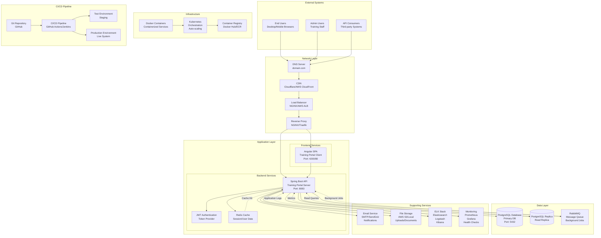
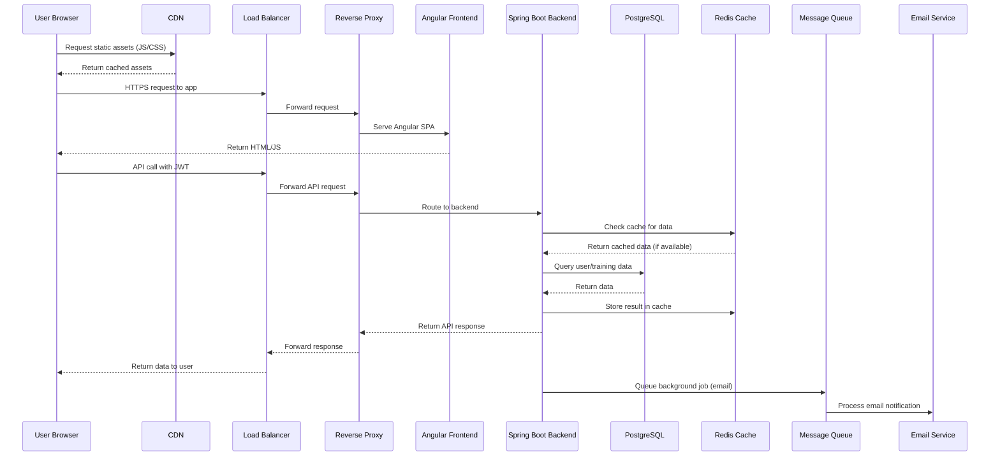

# Training Management System - Complete System Design

## High-Level System Architecture

## System Components Breakdown

### **1. External Systems**
- **End Users**: Desktop/mobile browsers accessing the training portal
- **Admin Users**: Training staff managing the system
- **API Consumers**: Third-party systems integrating with the API

### **2. Network Layer**
- **DNS**: Domain name resolution (e.g., training-portal.com)
- **CDN**: Content delivery network for static assets (CSS, JS, images)
- **Load Balancer**: Distributes traffic across multiple server instances
- **Reverse Proxy**: Handles SSL termination, routing, and security headers

### **3. Application Layer**

#### **Frontend Services**
- **Angular SPA**: Single-page application served via NGINX
- **Features**: Responsive UI, role-based navigation, real-time updates

#### **Backend Services**
- **Spring Boot API**: RESTful API server with JWT authentication
- **JWT Authentication**: Token-based security with role-based access control
- **Redis Cache**: Session storage, user data caching, API response caching

### **4. Data Layer**
- **PostgreSQL Primary**: Main database for user data, training records
- **PostgreSQL Replica**: Read replica for performance and high availability
- **RabbitMQ**: Message queue for background jobs (email notifications, report generation)

### **5. Supporting Services**
- **Email Service**: SMTP server or service (SendGrid) for notifications
- **File Storage**: AWS S3 or local storage for document uploads
- **ELK Stack**: Elasticsearch, Logstash, Kibana for log aggregation and analysis
- **Monitoring**: Prometheus for metrics, Grafana for dashboards, health checks

### **6. Infrastructure**
- **Docker**: Containerization of all services
- **Kubernetes**: Container orchestration, auto-scaling, rolling deployments
- **Container Registry**: Storage for Docker images

### **7. CI/CD Pipeline**
- **Git Repository**: Source code management
- **CI/CD Pipeline**: Automated testing, building, and deployment
- **Test Environment**: Staging environment for QA
- **Production Environment**: Live production system

## Data Flow Architecture

## Scalability Considerations

### **Horizontal Scaling**
- **Load Balancer**: Distributes traffic across multiple backend instances
- **Database Replication**: Read replicas handle read-heavy workloads
- **CDN**: Global distribution of static assets
- **Kubernetes**: Auto-scaling based on CPU/memory usage

### **Caching Strategy**
- **Redis**: Session storage, API response caching, user data
- **CDN**: Static asset caching with long TTL
- **Database Query Caching**: Frequently accessed data

### **High Availability**
- **Multiple AZs**: Services deployed across availability zones
- **Database Failover**: Automatic failover to replica
- **Health Checks**: Automatic removal of unhealthy instances

## Security Architecture

```mermaid
graph TD
    subgraph "Security Layers"
        A[Network Security<br/>Firewalls, VPC]
        B[Application Security<br/>JWT, RBAC, Input Validation]
        C[Data Security<br/>Encryption at Rest/Transit]
        D[Monitoring Security<br/>SIEM, Intrusion Detection]
    end

    subgraph "Authentication & Authorization"
        E[JWT Tokens<br/>HS256 Signing]
        F[Role-Based Access<br/>8 User Roles]
        G[Password Security<br/>BCrypt Hashing]
    end

    subgraph "Compliance"
        H[GDPR Compliance<br/>Data Protection]
        I[Audit Logging<br/>Security Events]
        J[Data Encryption<br/>PII Protection]
    end

    A --> B
    B --> C
    C --> D

    E --> F
    F --> G

    H --> I
    I --> J
```

## Deployment Architecture

### **Development Environment**
- Local Docker containers
- Hot reload for frontend/backend
- Local PostgreSQL database
- In-memory Redis

### **Staging Environment**
- Kubernetes cluster
- Full CI/CD pipeline
- Automated testing
- Production-like configuration

### **Production Environment**
- Multi-region deployment
- Auto-scaling groups
- Database replication
- Comprehensive monitoring

## Performance Metrics

### **Response Times**
- Frontend: < 2 seconds initial load
- API calls: < 500ms average
- Static assets: < 100ms (CDN cached)

### **Availability**
- 99.9% uptime SLA
- Automatic failover
- Graceful degradation

### **Scalability**
- Handle 10,000+ concurrent users
- Auto-scale based on load
- Database read/write splitting

This comprehensive system design shows how all components work together to deliver a robust, scalable, and secure training management platform. The architecture supports high availability, security, and performance requirements typical of enterprise applications. 🚀